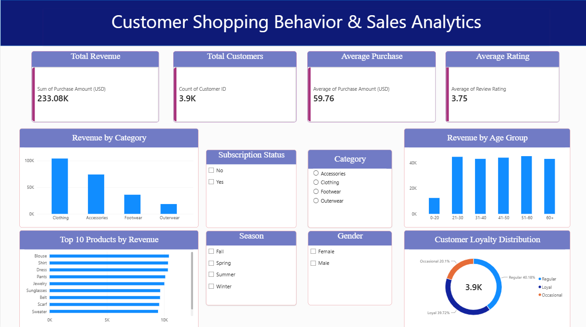

# Customer Shopping Behavior & Sales Analytics

## Project Overview
This project analyzes customer shopping behavior to identify sales trends, purchasing patterns, customer loyalty, and product performance. It combines Python, SQL, and Power BI to transform raw customer data into useful business insights.

## Dashboard Preview




## Objectives
- Analyze overall revenue and average purchase value.
- Identify top-performing product categories and items.
- Explore purchasing patterns across age groups and genders.
- Analyze customer loyalty using previous purchase history.
- Build an interactive dashboard for business decision-making.

## Tools & Technologies
- **Python:** Pandas, NumPy, Matplotlib, Seaborn
- **SQL:** Data analysis, aggregations, CASE statements, CTEs, and window functions
- **Power BI:** Interactive dashboard, KPIs, charts, and slicers
- **Jupyter Notebook:** Data cleaning and exploratory data analysis

## Project Workflow
1. Inspect and clean the customer shopping dataset.
2. Handle missing values and duplicate records.
3. Perform exploratory data analysis (EDA) using Python.
4. Use SQL queries to answer business questions.
5. Create customer loyalty segments based on previous purchases.
6. Build an interactive Power BI dashboard.
7. Summarize findings and potential business recommendations.

## Key Dashboard Metrics
- Total Revenue
- Total Customers
- Average Purchase Amount
- Average Review Rating
- Revenue by Category
- Top 10 Products by Revenue
- Revenue by Age Group
- Customer Loyalty Distribution

## Key Business Insights

- **Total Revenue:** The dataset generated a total purchase amount of **$233,081** across 3,900 customer records.
- **Top Revenue Category:** Clothing generated the highest revenue at **$104,264**, followed by Accessories at $74,200.
- **Top Products:** Blouse ($10,410), Shirt ($10,332), and Dress ($10,320) were the top three products by total purchase amount.
- **Age-Group Analysis:** Customers aged **51–60** contributed the highest revenue at **$45,316**, followed by the 21–30 age group at $44,775.
- **Customer Loyalty:** Regular customers accounted for **40.18%** of records, Loyal customers for **39.72%**, and Occasional customers for **20.10%**.
- **Average Purchase Amount:** The average purchase amount was **$59.76**.

## Business Recommendations

- **Strengthen Clothing Sales:** Prioritize marketing campaigns and product assortment strategies for Clothing, the highest-revenue category.
- **Promote Top Products:** Evaluate promotional opportunities for Blouses, Shirts, and Dresses while monitoring their profitability.
- **Target Customer Segments:** Develop campaigns tailored to different age groups based on their purchasing patterns.
- **Encourage Customer Retention:** Explore loyalty rewards and personalized offers to encourage repeat purchases among Regular and Occasional customers.
- **Improve Decision-Making:** Use the Power BI dashboard to monitor revenue, category performance, product trends, and customer loyalty over time.

## Repository Structure
```text
Customer-Shopping-Behavior-Analysis/
├── Dataset/
│   ├── customer_shopping_behavior.csv
│   └── customer_shopping_behavior_cleaned.csv
├── Python/
│   └── customer_behavior_analysis.ipynb
├── SQL/
│   └── customer_behavior_analysis.sql
├── PowerBI/
│   └── customer_shopping_behavior_dashboard.pbix
├── Images/
│   └── dashboard.png
└── README.md
```

## Business Value
The analysis helps a retail business understand which categories generate the most revenue, how purchasing behavior differs across customer segments, and where targeted marketing or customer-retention strategies may be useful.

## Disclaimer
This project is for educational and portfolio purposes. Insights and recommendations are based on the available dataset and should be validated against real business data before implementation.